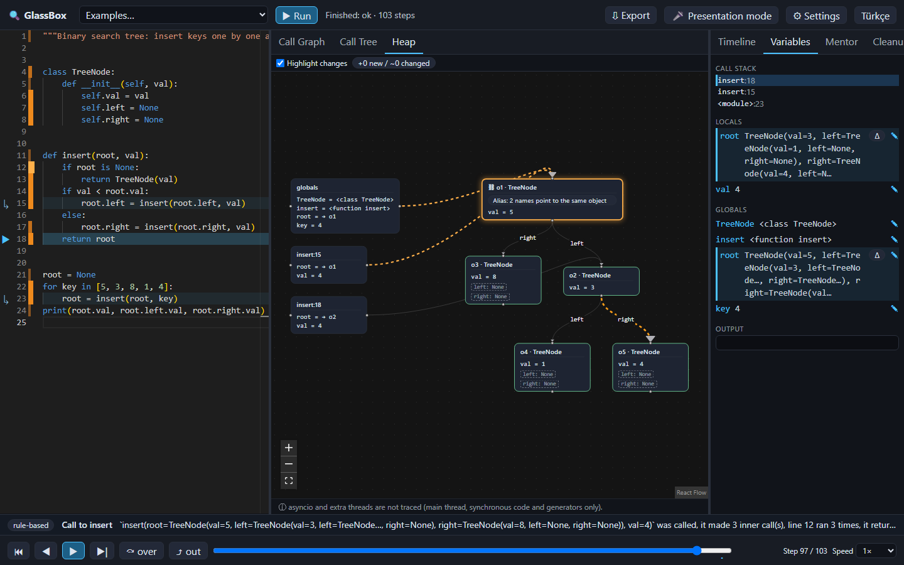
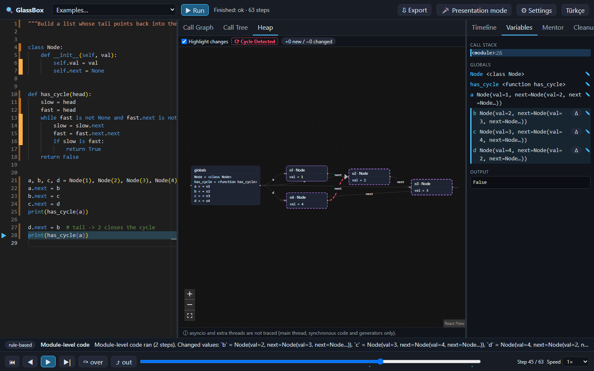
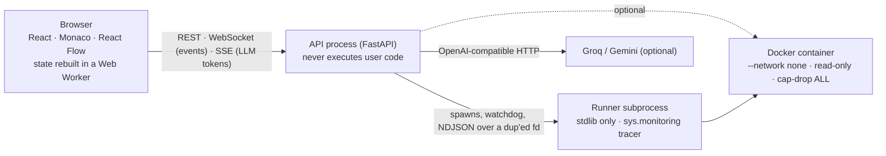

# GlassBox v2

> *See what your Python code actually does — a visual time-travel debugger, data structure visualizer, call graph explorer, and empirical Big-O laboratory.*

This is the v2 line (`yakuparslan0/Glassbox-v2`). The v1 release (v1.0.x, without the data structure visualizer) lives
at [yakuparslan0/Glassbox](https://github.com/yakuparslan0/Glassbox).

**See your Python code run.** GlassBox executes a Python program in an isolated process, records every step, and
lets you scrub back and forth through it: call graph, variables, heap and aliasing, dead and cold code, bottlenecks,
a rule-based (and optionally LLM-powered) mentor, measured refactorings, "what if I change this value?" branches,
root-cause tracing of crashes, and an empirical Big-O lab. The UI is Turkish by default (English included).

<p align="center"></p>

<p align="center"></p>

> ## Security warning
> The default `subprocess` sandbox is **not a security boundary**. It protects against runaway loops, memory and
> accidents, **not against malicious code**. The server therefore binds `127.0.0.1` only, and it **refuses to start**
> with `GLASSBOX_ALLOW_REMOTE=true` unless `SANDBOX_MODE=docker`. Do not expose GlassBox to other machines without the
> Docker mode. Details: [docs/SECURITY.md](docs/SECURITY.md).

## What's new in v2.0.0

- **Data structure visualizer.** The Heap tab detects the shape of each connected group of objects: a `left`/`right`
  field makes it a **tree** (top-down layout), `next`/`prev` a **linked list** (left-to-right chain), anything else a
  **general graph**. Layout is done with dagre; pointer fields are drawn as arrows labelled with the field name, and
  primitive fields (`val = 10`) stay inside the box. Frames sit on the left, structures on the right.
- **Time-travel heap diff.** Every step is compared with the previous one, whether you step forward, scrub backwards,
  or jump: new objects get a `+ NEW` badge (green), changed fields are highlighted (amber), and pointers that now point
  somewhere else are drawn as animated orange arrows. A toggle and a `+new / ~changed` counter sit above the view.
- **Null pointer badges.** In trees and linked lists, `left`/`right`/`next`/`prev` fields that are `None` are shown as
  dashed `left: None` style badges instead of plain rows.
- **Cycle detection.** A DFS marks the edge that closes a reference cycle (red, dashed) and Tarjan's strongly
  connected components mark every object on a cycle; a *Cycle detected* badge appears above the view. `prev` and
  `parent` back-links are ignored, so a doubly linked list is not reported as a cycle.
- **References kept past the depth limit.** The serializer stops at depth 3. An object the client already has is
  now sent as `{"ref": "oX"}` at that limit instead of a truncated placeholder, so long lists and deep trees keep
  every arrow (see [docs/DECISIONS.md](docs/DECISIONS.md)).
- **New examples:** `reverse_list.py` (in-place reversal with `prev`/`curr`/`nxt`), `bst_insert.py` (binary search
  tree insertion) and `cycle_detection.py` (Floyd's slow/fast pointers), with Turkish and English titles in the
  example picker.

## Run it in 30 seconds

Requirements: Python 3.13+ and Node.js 22+.

```bash
git clone https://github.com/yakuparslan0/Glassbox-v2.git && cd Glassbox-v2
python -m venv .venv && . .venv/bin/activate          # Windows: .venv\Scripts\activate
make install                                          # pip install -e "backend[dev]" and npm ci
make dev                                              # API on 127.0.0.1:8000 + UI on http://localhost:5173
```

Open http://localhost:5173, pick an example, press **Run**. No API key is needed: the app is fully usable with the
built-in rule-based narration. (`make` missing? run `python scripts/dev.py`.)

Terminal only: `glassbox trace examples/fib_naive.py`, `glassbox report examples/dead_code_zoo.py`,
`glassbox export examples/crash_chain.py --html replay.html`.

## See it without installing anything

Real files produced by `glassbox export` (single HTML files, no network, no server):

- [fib_naive replay](docs/examples/fib_naive.replay.html) (thinned to 400 KB: jumps between snapshots)
- [alias_bug replay](docs/examples/alias_bug.replay.html) · [crash_chain replay](docs/examples/crash_chain.replay.html) · [bubble_sort replay](docs/examples/bubble_sort.replay.html)
- Call graph of `crash_chain`: [SVG](docs/examples/crash_chain.svg) · [Mermaid](docs/examples/crash_chain.mmd)

## What you get

| Area | What it does |
|---|---|
| Time travel | Back / forward / step over / step out / scrubber with exception, output, library-call and divergence markers; works live while the program is still running. |
| Views | Call graph (dagre), call tree, heap view with tree / linked-list / graph layouts, step diff, cycle and alias highlighting, virtualized timeline, variables with per-variable history. |
| Mark & Sweep | Static reachability + what actually ran: confirmed-dead, cold and suspect code, duplicate blocks, unused imports/variables, reclaimable lines. |
| Bottlenecks | Hot loops, repeated computation (memoization candidates), loop invariants, mutable defaults, alias mutation; untraced `cProfile` / `tracemalloc` passes for real time and memory. |
| Mentor | Scene-based narration. Layer A (rules, instant, no key) always works; Layer B (LLM via Groq/Gemini) is opt-in per click. |
| Verified refactoring | Safe auto-fixes without an LLM; LLM proposals are validated, never auto-applied, and speed claims are only shown after a measured comparison. |
| What-If | Change a value at any step, re-run deterministically, compare branches and see where they diverge. |
| Root cause | Backward trace from an uncaught exception to where the faulty value came from. |
| Big-O lab | Fits step counts for growing inputs to 1, log n, n, n log n, n², n³, 2ⁿ; compares with a static estimate and flags contradictions. |
| Export | Mermaid, SVG, single-file Replay HTML; presentation mode (`Space`, `←/→`, `Shift+←/→`, `[ ]`, `F`). |

Honest numbers: a traced run reports **step counts** (deterministic); real time and memory come from separate
**untraced** passes, and the UI labels which pass a number came from.

## Architecture



Stack: Python 3.13+ (FastAPI, Pydantic v2; the runner uses the standard library only), React + TypeScript (Vite,
Zustand, Monaco, React Flow, dagre). Event types for the frontend are generated from the Pydantic models.

More in [docs/ARCHITECTURE.md](docs/ARCHITECTURE.md); design decisions in [docs/DECISIONS.md](docs/DECISIONS.md); the original
specification in [docs/SPEC.md](docs/SPEC.md).

## LLM (optional)

Copy `.env.example` to `.env` and fill `GROQ_API_KEYS` / `GEMINI_API_KEYS`. A provider is active only when its keys,
model **and** base URL are set. Source code leaves your machine only when you click an LLM button.

## Development

```bash
make test        # backend (python -m pytest backend/tests) + frontend (cd frontend && npx vitest run)
make lint        # ruff + tsc
make schema      # regenerate JSON Schema + frontend/src/types/generated.ts from the Pydantic models
```

CI (GitHub Actions, on pushes and pull requests to `main`): ruff, schema check and pytest on Python 3.13 and 3.14;
`tsc --noEmit`, vitest and the Vite build for the frontend.

Live acceptance checks against a running stack: `GLASSBOX_LIVE=http://127.0.0.1:5173 npx vitest run` in `frontend/`.
Items that need eyes on the UI are listed in [docs/MANUAL_CHECKLIST.md](docs/MANUAL_CHECKLIST.md).

## Known limitations

- Traced: main thread, synchronous code and generators. `asyncio` and extra threads are not traced (the UI says so).
- The tracer is slow (it records every step); the default limits are 20,000 steps and 10 s.
- The Docker mode and the Docker images were written without a Docker installation at hand and have not been run end to end.
- What-If shows the main run and one branch at a time with a divergence marker on the scrubber (not two overlaid tracks).
- Data structure detection is a heuristic based on field names (`left`, `right`, `next`, `prev`); the heap diff
  compares a step with the step right before it. An object reached for the first time deeper than 3 levels is still a
  truncated placeholder, and a change that happens only beyond that depth is not re-sent.

## Roadmap

Multi-file projects in the UI, asyncio/thread tracing, live narration while a run is in progress, shareable replays
with embedded What-If branches, a hosted demo with the Docker sandbox.

## License

MIT
